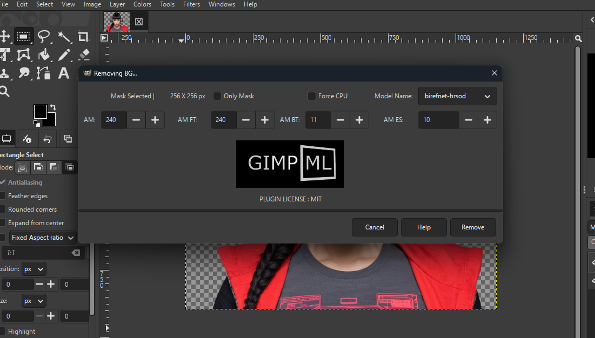

# GIMP-ML Remove Background — Stable

A focused package for the GIMP-ML Remove Background plugin, based on
the GIMP3-ML project and extended with additional BiRefNet sessions.

This repository preserves the existing model-processing implementation.
It is intended for users who want the Remove Background functionality
without cloning the entire GIMP-ML project.

## Features

- GIMP 3 Python plugin interface
- 13 selectable background-removal models
- Optional alpha matting
- Optional mask-only output
- CPU inference option
- Additional BiRefNet General, General Lite, DIS, and HRSOD sessions

## Screenshots

### GIMP-ML Remove Background Interface

## Supported models

1. `u2net`
2. `u2net_human_seg`
3. `u2netp`
4. `u2net_cloth_seg`
5. `isnet-general-use`
6. `isnet-anime`
7. `birefnet-portrait`
8. `silueta`
9. `birefnet-general`
10. `birefnet-general-lite`
11. `birefnet-dis`
12. `birefnet-hrsod`
13. `birefnet-cod`

## Requirements

- GIMP 3 with Python plugin support
- Python environment compatible with the installed GIMP-ML plugin
- Python packages required by the inference code, including ONNX Runtime,
  NumPy, Pillow, SciPy, and PyMatting
- Model weight files for the selected model

Exact package versions and installation steps should be validated against
the target GIMP and Python environment before a release.

## Model weights

Model weights are intentionally not included in this Git repository.
Many ONNX files exceed GitHub's regular file-size limit.

The first eight models use the download or lookup logic defined in
`gimpml/tools/rembg/session_factory.py`. Verify that their required weights
can be obtained successfully in your environment.

The following five models require their corresponding files under
`gimpml/weights/u2net/`:

| Model | Required file |
|---|---|
| BiRefNet General | `BiRefNet-general-epoch_244.onnx` |
| BiRefNet General Lite | `BiRefNet-general-bb_swin_v1_tiny-epoch_232.onnx` |
| BiRefNet DIS | `BiRefNet-DIS-epoch_590.onnx` |
| BiRefNet HRSOD | `BiRefNet-HRSOD_DHU-epoch_115.onnx` |
| BiRefNet COD | `BiRefNet-COD-epoch_125.onnx` |

Obtain each weight from its legitimate source and review its applicable
license and usage restrictions before downloading, redistributing, or
using it commercially. This repository does not grant rights to model
weights or third-party assets.

## Configuration

The plugin uses `gimpml/gimpml_config.json` for local Python and weights
paths. This machine-specific configuration is intentionally excluded from
version control.

Use the project's `gimpml/init_config.py` as a starting point for generating
local configuration. Confirm that the Python executable and weights path
point to the correct locations on your computer before running the plugin.

Do not commit personal absolute paths, credentials, or local configuration
files.

## Installation status

This repository is being prepared as a focused distribution. A clean
installation procedure and fresh-environment test are still required before
considering it a ready-to-install release.

## Credits and licensing

The original GIMP-ML code includes the MIT license provided in `LICENSE.md`.
This package is based on upstream GIMP3-ML code and related components.
Retain upstream copyright notices and attribution.

Individual model weights, libraries, and third-party assets may have
different licenses or restrictions. Review those licenses independently.
The MIT license for the code does not automatically grant commercial-use
rights for every model weight.

## Disclaimer

This project is provided as-is. Compatibility, model availability,
installation behavior, and licensing must be verified for each release.
